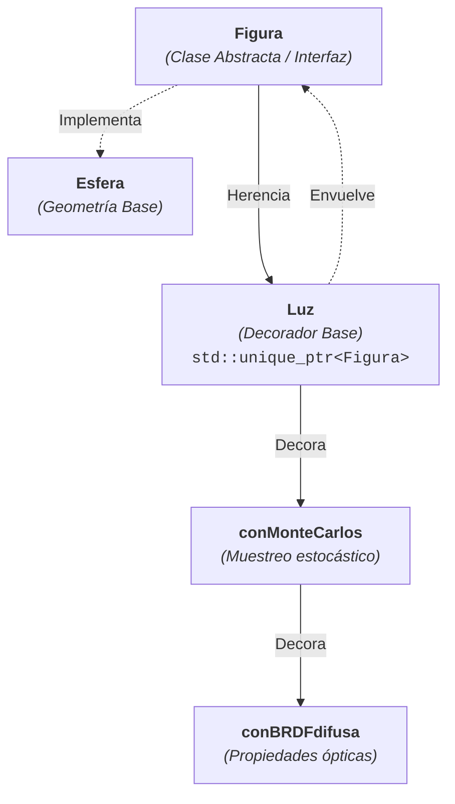

# 🎨 C++ Ray Tracer & Rendering Engine (Monte Carlo & BRDF)

Motor de renderizado y trazado de rayos (*Ray Tracer*) construido desde cero en **C++ moderno**. El sistema modela la interacción física de la luz sobre geometrías 3D utilizando **Integración de Monte Carlo** para estimación de iluminación y modelos de reflectancia **BRDF difusa**, exportando el resultado en imágenes de formato **PPM**.

---

## 📌 Aspectos Técnicos Destacados

* **Ray Tracing Basado en Física:** Cálculo numérico de intersecciones Rayo-Geometría (`intersect`), cálculo de vectores normales y sombreado continuo.
* **Integración por Monte Carlo:** Muestreo estocástico (*stochastic sampling*) para la estimación de iluminación global, cálculo de sombreado y suavizado de sombras.
* **Iluminación (BRDF):** Implementación de funciones de distribución de reflectancia bidireccional (*Bidirectional Reflectance Distribution Function*) para simular materiales difusos e intensidad lumínica.
* **Arquitectura Orientada a Objetos y Patrones de Diseño:**
  * **Patrón Decorador (Decorator Pattern):** Permite añadir dinámicamente comportamientos físicos (como propiedades de luz, BRDF o muestreo de Monte Carlo) envolviendo instancias de geometrías base (`Figura`).
  * **Gestión Eficiente de Memoria (Modern C++):** Uso estricto de punteros inteligentes (`std::unique_ptr`) y semántica de movimiento (`std::move`) para transferencias de propiedad sin *memory leaks*.
* **Exportador PPM:** Renderizado directo a formato de imagen sin dependencia de librerías gráficas pesadas de terceros.

---

## 🏗️ Patrón de Diseño & Arquitectura

El motor utiliza una estructura polimórfica extensible basada en el patrón **Decorator**:

### Ejemplo de Composición Dinámica
Mediante el uso de `std::move`, el sistema "decora" dinámicamente un objeto básico:

// 1. Instancia base
std::unique_ptr<Figura> miEsf = std::make_unique<Esfera>(r, p, c);

// 2. Decoración con muestreo estocástico (100 muestras)
miEsf = std::make_unique<conMonteCarlos>(std::move(miEsf), 100);

// 3. Decoración con BRDF Difusa
miEsf = std::make_unique<conBRDFdifuda>(std::move(miEsf), intensidad); 

## Visualización del resultado

## Autor
Odilón Avila Castrejón — Estudiante de Ingeniería en Computación (UMSNH) 

LinkedIn: https://www.linkedin.com/in/odil%C3%B3n-avila-castrejon-484757384/
